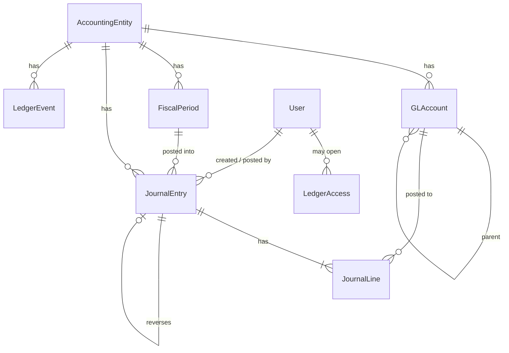

# FAS-03: ledger data model, owner-only access and deployment (design)

**Status: proposal, not approved.** Nothing here authorises code, a test, a migration, a switch, a seed, a deploy or a read of staging or production data. Coach Ed approves (or changes) this design first; the stage 2 builders then work from the approved text.

ClickUp: [z8uq9md5de](https://app.clickup.com/t/z8uq9md5de), folder "Financial Accounting System", master task FAS-00 (`z8uq9md5db`). Date: 2026-11-11. Backend `origin/main` at `1af6d25`.

Inputs: the FAS-01 inspection report (`docs/superpowers/specs/2026-11-11-fas-01-accounting-inspection.md`, PR 110, cited as "FAS-01 §n"), the FAS-03 task text, and the code named below, all read at `1af6d25`. Coach Ed's rulings of 2026-11-11 (new codebase only, bank transfer with proof, no new Django admin screens, the BIR invoice register is Billing B5's) set the scope. Nothing is copied from TWCinc; its ideas (single writer, idempotent replay, draft/post/reverse, period close) are used as ideas only.

Tags: **[I]** inspected by me at the path given; **[P]** proposed by me; **[A]** an assumption about another builder's topic (section 9).

## 0. Summary

1. **One new Django app, `apps/ledger`**, tables prefixed `ledger_`, seven tables in the first migration: `AccountingEntity` (the book), `Account`, `FiscalPeriod`, `JournalEntry`, `JournalLine`, `LedgerEvent` (append-only change history) and `LedgerAccess` (who may open the books). Amounts are `BigIntegerField` centavos. The chart itself (which accounts exist) is data from FAS-32, never in the migration.
2. **One writer, `apps/ledger/posting.py`.** Draft, edit, post, reverse. Posting is one transaction under a row lock on the book: balance check, period check, idempotent replay with payload comparison, a gapless posting sequence number and a hash seal. No other module writes a journal row; a test enforces that.
3. **A posted entry is immutable in two layers.** Django (model and queryset guards) and PostgreSQL (triggers, added in a second migration). **Correction to FAS-01 §6.4:** CI is not SQLite-only. `.github/workflows/ci.yml` has a second job, `postgres-and-redis`, that runs the whole test suite against PostgreSQL 16 [I]. Trigger tests can therefore run in CI.
4. **The billing hook goes inside the `confirm_transfer` transaction** (recommended), through one small registry in billing so that the ledger and PR 107 do not both rewrite the function. A ledger failure then refuses the confirmation instead of leaving a payment with no entry. This is a money rule; Coach Ed decides (Q2).
5. **Owner-only access is a row, not a role:** `LedgerAccess`, granted only by a terminal command and audited, exactly like the existing `InboxAccess`. Enforcement is one wrapper that the ledger's own route table applies to every route, plus a route-inventory test. Coach Ed decides (Q1).
6. **Staging cannot touch real books:** the book has a kind, `rehearsal` or `live`; a live book can be opened only where `LEDGER_LIVE_BOOKS=1`, which is set nowhere but production (which does not exist yet).
7. **Stage 2 splits into one short foundation piece (schema) followed by five builders on disjoint files**, with the four contended files each edited exactly once, by a named piece (section 8).

## 1. Decisions needed from Coach Ed

Each has a recommended default. None is decided here.

| # | Question | Recommended default | If the answer differs |
|---|---|---|---|
| Q1 | **Who may open the books, and where does the rule attach?** Options: (a) a capability argument on the shared staff gate `_for_staff`; (b) a `LedgerAccess` row per staff user, checked by a wrapper the ledger applies to every one of its routes; (c) a Django group or permission; (d) a check inside each handler. | (b). Section 5 gives the reasons. A superuser has no access without a row. | (a) is the strongest attachment but edits the gate that billing, inbox and contacts also use; it can be added later on top of (b). (c) and (d) are weaker (section 5.2). |
| Q2 | **Does the journal entry for a confirmed payment commit with the confirmation, or afterwards?** | Inside the same transaction. If the ledger cannot post (no account mapping, period locked, switch half set), the operator's confirmation is refused with a clear error and nothing is half-written. | "Afterwards" keeps confirmation independent of the books but needs an outbox, retries and a daily check, and the books can lag. Section 3.5. |
| Q3 | **Who owns the books, and is there ever a second reader?** Which staff users get `owner`? Is a CPA read-only login wanted, and when? | One owner (Coach Ed's own staff identity). No CPA login until one is named, and not before billing and inbox routes gain their own access rows (section 5.6). | n/a |
| Q4 | **May a live book exist on staging?** | No. `rehearsal` books only on staging; `live` only where `LEDGER_LIVE_BOOKS=1`, and no staging entry is ever copied to a live book. | A staging "dress rehearsal with real figures" would need a written exception. |

Routine decisions I took (reversible, inside scope) are in section 10 with what, why and source.

## 2. Data model

### 2.1 App and naming

[P] App `apps/ledger`, Django label `ledger`, model names without a "Ledger" prefix unless needed to avoid a clash. "Account" alone would clash in meaning with `accounts.Account` (a Subscriber); the model is therefore named **`Account`** in the ledger app only if its related names stay explicit, otherwise **`GLAccount`**. I use `GLAccount` below to remove the confusion for readers and for `ForeignKey` names. This is a naming decision (routine, section 10, R1).

All ids that leave the API are public ids from `apps/common/ids.py:new_public_id` (prefix + 20 Crockford characters) [I `common/ids.py:11-19`]; a primary key never leaves the server. Prefixes: `ent`, `gla`, `per`, `jrn`, `lev`.

### 2.2 ERD



`JournalEntry` carries its source as three plain columns (`source_type`, `source_ref`, `source_event`); there is no foreign key to billing (section 2.4, decision R4).

### 2.3 Tables

Conventions that apply to every table below: `id` is a `BigAutoField` (the repository default, `apps/billing/apps.py` [I]); `created_at` is `auto_now_add`; every `ForeignKey` is `PROTECT` (nothing in the books is cascaded away) except `JournalLine.entry`, which is `CASCADE` only so that a *draft* can be deleted, and is guarded against that for a posted entry (section 2.5); money is centavos in a `BigIntegerField` (signed 64-bit, maximum about PHP 92 quadrillion; FAS-01 §6.4 notes that `PositiveIntegerField` at about PHP 21.5 million is too narrow for balances) and is never a float or a `DecimalField`; dates that decide a period are Manila calendar dates (`TIME_ZONE = "Asia/Manila"`, `USE_TZ = True` [I `settings.py:282,286`]).

#### `ledger_entity` (`AccountingEntity`): the book

One row per set of books. NegosyoOnline's own business is one row; the table exists so that every other table is scoped by a foreign key and a second set of books (or a rehearsal) cannot mix with the first (FAS-03 task: "internal AccountingEntity boundary").

| Field | Type | Notes |
|---|---|---|
| `public_id` | char(40), unique | `ent_...` |
| `name` | char(120) | e.g. "NegosyoOnline" |
| `kind` | char(12): `live`, `rehearsal` | Section 7. Immutable after creation (Django guard). |
| `currency` | char(3), default `PHP` | Check: equals `PHP` for now. One currency per book. |
| `first_fiscal_month` | smallint, default 1 | Check 1..12. Calendar year Jan to Dec per the FAS-00 contract. |
| `next_posting_seq` | bigint, default 1 | The counter the writer increments under the row lock (section 3.3). |
| `last_seal` | char(64), blank | Hash of the latest posted entry (section 2.5). |
| `created_at`, `created_by` | | `created_by` is a `User`. |

Constraints: partial unique on `kind` where `kind='live'` (at most one live book, [P]); `name` unique.

#### `ledger_account` (`GLAccount`): the chart as data

Rows are created by FAS-32's approved list through the account service (FAS-05), never by a migration (no seed without approval). The model does not know any account.

| Field | Type | Notes |
|---|---|---|
| `public_id` | char(40), unique | `gla_...` |
| `entity` | FK `AccountingEntity` | |
| `code` | char(16) | Text, not a number. Unique with `entity`. Stable: the writer refuses to change a code once a line points at the account. |
| `system_key` | char(40), null | A stable name the posting rules use instead of a code (for example the account that receives bank-transfer cash). Unique with `entity` where not null. **[A]** FAS-32 names the keys (section 9). |
| `name` | char(160) | |
| `type` | char(10): `asset`, `liability`, `equity`, `income`, `expense` | The five classes of a double-entry book. "Direct costs", "other" and the like are reporting groups, not types. |
| `normal_side` | char(6): `debit`, `credit` | Check: `asset` and `expense` are `debit`; `liability`, `equity`, `income` are `credit`. FAS-03 asks for a stored normal balance. |
| `reporting_group` | char(60), blank | Free text from FAS-32 (for example "Direct costs"). Not constrained by the schema. |
| `parent` | FK self, null | The hierarchy. |
| `is_header` | bool | A header groups children and takes no line (the writer refuses; a PostgreSQL trigger repeats the check). |
| `effective_from`, `effective_to` | date, null | The dates between which a line may post. `effective_to >= effective_from`. FAS-03 asks for effective dates. |
| `is_active` | bool | An account is deactivated, never deleted. `delete()` raises. |

A balance is never stored on an account.

#### `ledger_period` (`FiscalPeriod`)

Monthly periods; a year is the twelve rows of one `year`.

| Field | Type | Notes |
|---|---|---|
| `public_id` | char(40), unique | `per_...` |
| `entity` | FK | |
| `year`, `month` | smallint | Unique with `entity`. Check `month` 1..12. |
| `start_date`, `end_date` | date | Manila calendar dates, derived once at creation. |
| `status` | char(12): `open`, `soft_closed`, `locked` | The states come from FAS-06 [A]; the column accepts exactly these three. |
| `status_changed_at`, `status_changed_by` | | The full history is in `LedgerEvent`. |

The writer creates a missing period (status `open`) under the book lock when a posting needs it; creating a period is not a policy choice. Moving a period to `locked` and reopening it are FAS-06's operations and are only through the period service (which writes a `LedgerEvent`). A period is never deleted.

#### `ledger_entry` (`JournalEntry`)

| Field | Type | Notes |
|---|---|---|
| `public_id` | char(40), unique | `jrn_...` |
| `entity` | FK | |
| `status` | char(8): `draft`, `posted` | Two values only. A reversed entry stays `posted`; its reversal is another entry (below). |
| `kind` | char(12): `manual`, `system`, `reversal`, `adjustment`, `opening` | `system` = written from a source event by a hook. |
| `entry_date` | date | The accounting date in Manila time. Decides the period. |
| `memo` | char(240), blank | |
| `period` | FK `FiscalPeriod`, null | Null while draft; set at posting; never changed. |
| `posting_seq` | bigint, null | Gapless per book, assigned at posting under the lock. Unique with `entity` where not null. |
| `posted_at`, `posted_by` | datetime, FK `User` null | `posted_by` null = the system. |
| `created_by` | FK `User`, null | |
| `idempotency_key` | char(160) | Unique with `entity`. Mandatory for every entry (a draft too). See below. |
| `payload_hash` | char(64) | SHA-256 of the canonical form of `entry_date`, `kind`, `memo` and the lines (account public id, side, amount, line memo, in line order). Used for replay comparison. |
| `source_type`, `source_ref`, `source_event` | char(40), char(64), char(40); blank | The source link (section 2.4). Unique together with `entity` where `source_type` is not blank. |
| `reverses` | one-to-one self, null | On a reversal entry: the entry it reverses. One-to-one means an entry can be reversed once. |
| `total_centavos` | bigint | Sum of debits = sum of credits, written at posting. Check `>= 0`. |
| `seal` | char(64), blank | Section 2.5. |
| `created_at` | datetime | |

Constraints: `status='posted'` requires `period`, `posting_seq`, `posted_at`, `seal` not null and `total_centavos > 0` (check); `kind='reversal'` iff `reverses` is not null (check); idempotency uniqueness as above. Indexes: `(entity, entry_date)`, `(entity, status)`, `(period)`.

**Idempotency.** For an entry written from a source event the key is derived: `"<source_type>:<source_ref>:<source_event>"` (for example `billing.banktransferpayment:btp_xxxxxxxx:payment_confirmed`; the payment's `public_id` is already one-to-one with a confirmation [I FAS-01 §3.2]). For a manual entry the staff app sends a random client key with the request, so a double click or a retried request cannot post twice. The key is the replay handle; the payload hash is the replay *check* (section 3.4).

**Reversal.** A posted entry is never edited. Reversing it creates a new entry of `kind='reversal'` whose lines are the original's with sides swapped, `reverses` pointing at the original, its own date and period. Whether an entry "is reversed" is the existence of that one row (`reverses` unique), never a flag on the original. A corrected replacement is a separate `adjustment` or `manual` entry.

#### `ledger_line` (`JournalLine`)

| Field | Type | Notes |
|---|---|---|
| `entry` | FK `JournalEntry`, CASCADE (draft deletion only) | |
| `line_no` | smallint | 1..n; unique with `entry`. |
| `account` | FK `GLAccount`, PROTECT | Must belong to the entry's book (writer and trigger check; Django cannot express a composite foreign key). |
| `debit_centavos`, `credit_centavos` | bigint, default 0 | Check: exactly one of them is greater than zero, the other is zero, neither is negative. |
| `memo` | char(240), blank | |

Indexes: `(account, entry)` for balances and drilldown; `(entry, line_no)` is the unique one. Sub-centavo amounts do not exist: any allocation rounds in the *caller*, by FAS-02's rule [A], before the writer sees it.

No dimension columns (party, product, site) in v1. A later stage adds nullable reference columns to the line by its own migration if FAS-24/25 need them (placeholders, section 2.6).

#### `ledger_event` (`LedgerEvent`): the change history

Append-only, one row per change to the books' structure or state: account created, renamed or deactivated; period status changed; entry posted, reversed, draft discarded; access granted or revoked; book opened. Written in the *same transaction* as the change it describes, so the history and the change commit together.

| Field | Type | Notes |
|---|---|---|
| `public_id` | char(40) | `lev_...` |
| `entity` | FK | |
| `kind` | char(40) | A fixed vocabulary in code, like `OperatorAuditEntry.action`. |
| `target_type`, `target_ref` | char(24), char(64) | `entry`, `account`, `period`, `access`... and its public id. |
| `actor` | FK `User`, null | Null = the system (a hook). |
| `detail` | JSON | Before and after of the changed fields (for an account rename, the old and new name), the payload hash for a posting. Never a secret and never a Subscriber's personal value: an entry's lines are not copied here. |
| `at` | datetime | `auto_now_add`, indexed. |

`save()` on an existing row and `delete()` raise (the pattern of `OperatorAuditEntry` [I `operators/models.py:81-115`]); the PostgreSQL guard makes it a database rule (section 2.5). The operator audit log and this table answer different questions: `OperatorAuditEntry` says *who looked at or did what in HQ* (including reads); `LedgerEvent` says *how the books changed*, and is part of the books' own record. Section 5.4 lists the few `OperatorAuditEntry` actions the ledger declares.

#### `ledger_access` (`LedgerAccess`): who may open the books

Modelled on `inbox.InboxAccess` [I `inbox/models.py:111-121`].

| Field | Type | Notes |
|---|---|---|
| `operator` | FK `User` | Unique with `entity` (one row per user per book). |
| `entity` | FK | |
| `level` | char(8): `owner`, `viewer` | `owner` reads, posts, closes periods and grants. `viewer` only reads. Only `owner` is granted in v1 (Q3). |
| `granted_by`, `granted_at` | | |
| `revoked_at`, `revoked_by` | null | A revoked row is kept (history); the check looks at `revoked_at IS NULL`. |

### 2.4 The source link to a `BankTransferPayment`

[P] **Loose reference, not a foreign key.** The entry stores `source_type="billing.banktransferpayment"`, `source_ref=<payment public_id>` (`btp_...` [I `models.py:158`, `services.py:744`]) and `source_event="payment_confirmed"`. Reasons:

- The journal must not make billing's migrations wait for ledger's, or the reverse. Billing has three plans that change `BankTransferPayment` (PRs 106, 107, 108, FAS-01 §8); a foreign key adds a cross-app migration dependency to each of them.
- The ledger switch can be off while billing is on. A foreign key would make every billing migration and test require the ledger tables.
- Billing's payment can never be deleted (`delete()` raises, `models.py:208` [I]), so a dangling reference cannot arise from deletion.
- The reverse lookup the ledger needs is "which confirmed payments have no entry". That is a query on `source_ref`, and it is a **control** (an HQ exception list and a test), not a constraint.

The cost: the database cannot prove the payment exists. The hook (section 3.5) is the only writer of these three columns for this source, it is called with the payment row in hand, and the control above catches a payment confirmed without an entry. If Coach Ed prefers a hard link, the alternative is a nullable one-to-one `ForeignKey("billing.BankTransferPayment", on_delete=PROTECT)` on `ledger_entry`, added by the migration that follows billing's; I do not recommend it for the reasons above.

The same three columns carry later sources (an expense bill, a bank statement line, a depreciation run) as `source_type` values, so no new table is needed per source.

### 2.5 Immutability

**What must hold.** A `posted` entry and its lines are never changed or deleted; a `LedgerEvent` is never changed or deleted; the sum of a posted entry's debits equals its credits; no line is added to, removed from or changed on a posted entry; an entry cannot post into a `locked` period.

**Layer 1: Django (works on SQLite and PostgreSQL).**
- `JournalEntry.save()` raises if the row in the database is `posted` (the loaded status is kept in `from_db`; a row loaded as `draft` may be saved, and only by the writer); `JournalEntry.delete()` raises unless the status is `draft`.
- `JournalLine.save()` and `.delete()` raise when the parent entry is not `draft`.
- The managers use a `QuerySet` whose `update()`, `bulk_update()`, `bulk_create()` and `delete()` refuse to touch a queryset that can contain a posted entry or any line of one (`filter(status="posted").exists()` is evaluated first); `ledger_event`'s queryset refuses all updates and deletes. This closes the gap FAS-01 §9 notes: `QuerySet.update` bypasses `save()` (billing's `_lapse_pending` uses it [I `services.py:449`]).
- **One writer.** An architecture test scans the source tree and fails if any module other than `apps/ledger/posting.py` (and migrations and tests) calls `create`, `update`, `delete` or `save` on `JournalEntry`, `JournalLine` or `LedgerEvent`. Billing's hook calls `posting`, never a model.
- `GLAccount.delete()`, `FiscalPeriod.delete()` and `AccountingEntity.delete()` raise.

**Layer 2: PostgreSQL (second migration, `ledger.0002_postgres_guards`).** `RunPython` that executes `CREATE FUNCTION ... CREATE TRIGGER` only when `connection.vendor == "postgresql"`, with a reverse that drops them. On SQLite the migration is a no-op.
- `BEFORE UPDATE OR DELETE` on `ledger_entry`: if `OLD.status = 'posted'` raise. The single allowed update is `draft` to `posted`, and only if `NEW.posting_seq`, `NEW.period_id`, `NEW.posted_at` and `NEW.seal` are set and `NEW.entry_date` falls inside the period's dates.
- `BEFORE INSERT OR UPDATE OR DELETE` on `ledger_line`: raise unless the parent entry is `draft`; on insert and update, raise if the account is a header, belongs to another book than the entry, or the entry date is outside the account's effective dates.
- `BEFORE UPDATE OR DELETE` and `BEFORE TRUNCATE` on `ledger_event`: raise.
- A `CONSTRAINT TRIGGER ... DEFERRABLE INITIALLY DEFERRED` on `ledger_entry` (after insert or update, when `NEW.status='posted'`): the lines must number at least two, and `SUM(debit) = SUM(credit) = NEW.total_centavos`. It runs at commit, so lines may be inserted in any order before it.
- The period lock is checked in the same posted-transition trigger: the period must be `open` (or `soft_closed` with the entry kind allowed by FAS-06 [A]).

**Layer 3: tamper evidence.** `seal = sha256(previous_seal || entity public id || posting_seq || payload_hash || entry_date || total_centavos)`, computed at posting under the book lock, `last_seal` kept on the entity. A check command (FAS-06) recomputes the chain and reports the first mismatch. This detects a change made by someone who disabled the triggers, which a database owner can do: the application connects as the database owner on Railway, so the triggers defend against the application and against mistakes, not against a database administrator. A separate, less privileged database role would defend against that too; it is a Railway change and out of scope here.

**Testing.** The Django layer is tested on both databases. The PostgreSQL layer is tested by tests marked to run only when `connection.vendor == "postgresql"`; the repository's `postgres-and-redis` CI job runs them on every PR [I `.github/workflows/ci.yml`, job at lines 42-84]. That job is a required check for `main` (the branch-protection setting lists "PostgreSQL and Redis configuration" beside "Django checks and tests", read with `gh api`), so a trigger test that fails blocks the merge.

### 2.6 Placeholders for later stages (names only, no table in v1)

Named so that later designs do not collide with them. None is created, migrated or modelled by stage 2.

| Placeholder | Stage | Notes |
|---|---|---|
| `BankAccount` | FAS-08 | NegosyoOnline's own receiving accounts as rows. Today only the variable `BILLING_TRANSFER_ACCOUNTS` (FAS-01 §2.1). A `GLAccount` of type asset would point at it. |
| `BankStatementImport`, `BankStatementLine`, `Match`, `Reconciliation` | FAS-08 | Statement import, matching, reconciliation. |
| `Supplier`, `SupplierBill`, `BillPayment` | FAS-09 | Accounts payable. A bill posts a `source_type="ledger.supplierbill"` entry. |
| `Asset`, `DepreciationRun`, `Loan`, `OwnerContribution` | FAS-11 | Fixed assets, loans, equity. |
| `FinancialDocument` | FAS-09 and later | A receipt or file linked to an entry or a bill, stored through `apps/common/private_files.py` [I]; never a public address. |
| `RecognitionSchedule` | FAS-14 | Release of deferred revenue by period. |
| `TaxPolicy`, `TaxRecord`, `WithholdingCredit` | FAS-20/21 | Policy is a CPA call. |
| `SaaSSnapshot` | FAS-24 | Metrics. |
| Line dimension columns | FAS-24/25 | Nullable references on `ledger_line`, by their own migration. |

## 3. The posting writer

All of this is `apps/ledger/posting.py`. Services raise `ApiError` (the one error shape, `common/errors.py` [I]) so staff handlers answer it unchanged.

### 3.1 Operations

| Function | What it does |
|---|---|
| `create_draft(entity, *, entry_date, memo, lines, kind, idempotency_key, actor)` | Validates shape (section 3.2), writes a `draft` entry and its lines. No period, no number. A replay of the same key returns the same draft. |
| `edit_draft(entry, *, entry_date=None, memo=None, lines=None, actor)` | Replaces the draft's fields and lines in one transaction; refuses a posted entry (`entry_posted`, 409). Updates `payload_hash`. |
| `discard_draft(entry, *, actor, reason)` | Deletes a draft and writes a `LedgerEvent`. Refuses a posted entry. |
| `post(entry, *, actor)` | Draft to posted (section 3.3). |
| `post_new(entity, *, entry_date, memo, lines, kind, idempotency_key, source=None, actor)` | Creates and posts in one transaction. This is what a hook calls. A replay returns the existing posted entry. |
| `reverse(entry, *, entry_date, reason, actor, idempotency_key)` | Creates and posts the reversal (section 3.6). |

### 3.2 Balanced-entry check and shape rules

Before anything is written (and again in the PostgreSQL trigger):
- at least two lines; each line has exactly one positive side; amounts are integers (a `bool`, a float or a string is refused, as `confirm_transfer` refuses a bool amount [I `services.py:893-897`]);
- `SUM(debit) == SUM(credit)` and the total is greater than zero; an unbalanced entry is refused with `entry_unbalanced` and names both totals;
- every account belongs to the entry's book, is not a header, is active, and the `entry_date` is within its effective dates;
- `entry_date` is a date, not a datetime; it is the Manila date.

### 3.3 Posting, in order

One `transaction.atomic()`:
1. `AccountingEntity.objects.select_for_update().get(pk=...)`. This lock serialises all posting in the book, which is the cost of a gapless number and a hash chain; the owner-only business posts a handful of entries a day, so contention is not a concern.
2. Replay check (section 3.4).
3. Find or create the `FiscalPeriod` for `entry_date`; refuse if `locked` (`period_locked`, 409). A `soft_closed` period accepts only the entry kinds FAS-06 names [A].
4. Re-validate the entry and lines against the *current* account rows (an account may have been deactivated since the draft).
5. Assign `posting_seq = entity.next_posting_seq`, increment it; compute `total_centavos`, `seal`; set `status='posted'`, `period`, `posted_at`, `posted_by`; update `entity.last_seal`.
6. Write the `LedgerEvent` (`entry_posted`, with `payload_hash`).
7. The deferred trigger re-checks the balance at commit (PostgreSQL).

Any refusal rolls back all of it. Nothing is skipped silently: the FAS-03 task text rejects the legacy habit of skipping a missing mapping or period with a warning ("not acceptable as an invisible failure"), so every missing precondition is an error to the caller.

### 3.4 Idempotent replay

`post_new` and `create_draft` look up `(entity, idempotency_key)` after the lock (or, for `create_draft`, a plain `get_or_create` guarded by the unique constraint):
- **Same key, same `payload_hash`:** return the existing entry, `replayed=True`; write nothing (the pattern of `_already_done` [I `services.py:322-352`]).
- **Same key, different payload:** refuse with `idempotency_conflict` (409) and write nothing. A source event whose amount later changed cannot silently overwrite a posted entry.
- **Different key, same `(source_type, source_ref, source_event)`:** the unique constraint refuses it.
- A concurrent second call blocks on the book lock, then takes the replay branch. A test with two threads (as `test_concurrency.py` does for billing [I]) proves it on PostgreSQL.

### 3.5 The billing hook: two options

The only money-in event is a confirmed `BankTransferPayment`, written in `confirm_transfer`'s `change()` function, inside `_write`'s transaction and under the subscription row lock [I `services.py:876-922`, FAS-01 §2.2].

**Option A (recommended): inside the transaction.** A call placed after `row.save()` and `_transfer_event(...)` and before `audit.record(...)`:

```
ledger_hook.on_payment_confirmed(row, cycle, now)   # may be None for a usage_only payment (PR 108)
```

- It does nothing at all while the ledger or its billing posting is off (`LEDGER_ENABLED` / `LEDGER_POST_BILLING_ENABLED`, section 6.1), and imports the ledger lazily so billing runs without the ledger tables.
- It builds the lines from the matrix FAS-32 delivers [A], with `source_type/ref/event` as in 2.4, `entry_date` = the Manila date of `now` (the confirmation moment) [A, FAS-02], and calls `posting.post_new(...)`.
- It writes only to ledger tables and takes the book lock *after* the subscription lock; the ledger never takes a subscription lock, so lock order is always subscription then book and a deadlock cannot form.
- A failure raises `ApiError`; `_write` rolls back the whole confirmation. The operator sees a clear error; the payment stays `submitted` and nothing is half-posted.
- A replayed confirmation returns early at `if row.status == CONFIRMED: return row` before the hook is reached, and if it did reach it, 3.4 returns the same entry.
- For entry date: using "today" (a confirmation can never be dated in a past month) means a locked, past period never blocks a live confirmation. This is why 3.3 step 3 cannot fail for the hook in normal operation.

*Cost:* the ledger now sits in the money path. A misconfigured chart (the account for `payment_confirmed` missing) stops confirmations until fixed. Mitigations: a `ledger_ready` check run before the posting switch is ever turned on, and the posting switch is separate from the ledger switch.

**Option B: afterwards** (`transaction.on_commit` plus a Celery task, or a periodic sweep). The confirmation commits alone; a worker posts later.
- Needs an outbox (a row written inside the confirmation, so a crash between commit and enqueue loses nothing), retries, a dead-letter list and an alarm. With no outbox, `on_commit` can fail after the payment is committed and nobody knows (the invisible failure the task rejects).
- Worker and beat run on staging only; production has none yet (FAS-01 §6.2).
- Books lag the cash; a trial balance can be wrong by the unposted payments; reports need an "unposted" warning.

**Why A:** at launch there is one payment a day at most, one transaction is the simplest thing that cannot lose an entry, and FAS-01 §11.2 Q8's default is the same. The cost of A (a refused confirmation) is visible and fixable; the cost of B (books that are quietly wrong) is not.

**Catch-up, either option.** `manage.py ledger_post_missing` (a terminal command, FAS-12) lists confirmed payments with no entry and posts them through the same `post_new` with the same key, so it is idempotent. It is needed once for payments confirmed before the posting switch was on and is the control from 2.4.

**Sequencing with PR 107's hook in the same function.** PR 107 plans `invoices.services.open_item(cycle, payment)` in `confirm_transfer`, after the cycle exists and before the audit entry, behind its own switch (FAS-01 §3.2, §8) [I via FAS-01]. PR 108 changes what a "confirmed payment" is (usage-only, no cycle). To keep three sessions from rewriting one function:
1. **One small extension point, written once:** `apps/billing/hooks.py` holding a list `AFTER_CONFIRMED = []` and a function `run_after_confirmed(row, cycle, subscription, now)`, with one call in `change()` before `audit.record`. Whoever of the ledger piece FAS-04c (section 8) or PR 107's builder lands second adapts to it. Each app registers its callable in its own `AppConfig.ready()` (billing already does this for proofs [I `billing/apps.py`]); the order is `ledger` first, `invoices` second, so an invoice is never opened for a payment the books refused. If PR 107 has already merged a direct call, the ledger piece converts it to the registry in the same PR and tells the coordinator.
2. The ledger hook never edits `BankTransferPayment`, `BillingCycle` or billing models.
3. The hook's signature takes the payment first and the cycle as optional, so PR 108's cycle-less payment fits without a change to the ledger.

### 3.6 Reversal

`reverse(entry, entry_date, reason)` in one transaction under the book lock: refuse if the entry is a draft, already reversed (`reverses` unique), or is itself a reversal; build the mirrored lines; post as `kind='reversal'` with key `reverse:<original public id>`; write a `LedgerEvent` carrying the reason. The reversal's date must be in a period the writer may post to; if the original's period is locked the reversal goes in the first open period (the caller chooses the date). A reversal of a cash entry that has been *reconciled* (FAS-08) needs FAS-08's rule; v1 refuses nothing on that ground because reconciliation does not exist yet. Refunds do not exist in billing (FAS-01 §4); a refund paid outside the system is a manual entry with a reason (FAS-01 §11.2 Q10 default).

## 4. Reads and reports

Not designed here beyond one rule that follows from the contract: **every figure is a sum of lines whose entry is `posted`**, computed in the database, never read from a payment status or a stored total. The balance of an account is `SUM(debit) - SUM(credit)` over its posted lines up to a date (sign by `normal_side`). On PostgreSQL `SUM` of `bigint` returns `numeric`; the reporting code casts to `int` and a test asserts the type. Drafts appear only in the entry list, marked as drafts, never in a total. Cursor pagination on `public_id` (`common/pagination.py`) orders by primary key only [I `pagination.py:10-21`], so a date-ordered ledger list needs a new keyset page function in `apps/ledger/` (not an edit to common).

## 5. Owner-only access

### 5.1 Facts [I]

- The staff gate admits any `User` with `is_staff`, an enrolled active identity and a verified two-step session; nothing narrower (`two_step.py:43-53`, `staff_views.py:66-80,186-194`; FAS-01 §5).
- `_for_staff(view)` calls `view(request, session.identity.user)`; routes of other apps are added with `ROUTES.update({path: ("POST", _for_staff(view)) ...})` (`staff_views.py:196-205`).
- No code reads `is_superuser`, `groups` or `user_permissions` for staff routes (FAS-01 §5.1).
- A per-module access row already exists as a pattern: `InboxAccess`, checked in one function `scope_for` (`inbox/access.py`), granted and revoked only by `manage.py sms_inbox_access` with `--actor`, each change audited with `sms_inbox_access` [I]. Its docstring: "the access is a row of its own, not a Django permission, and a superuser has none without it."

### 5.2 Options

| | Attaches to | For | Against |
|---|---|---|---|
| **(a)** capability argument on `_for_staff` | The shared gate | A route cannot be registered without naming a capability; cannot be forgotten. | Edits the one function billing, inbox and contacts share, in a contended file; the capability still needs a source (a column, a group or a table). |
| **(b)** an access row + a wrapper on the ledger's own route table | A property of the identity (a row), enforced where the ledger builds its `ROUTES` | Follows the `InboxAccess` precedent exactly; revocable and auditable; a superuser is not implicitly an owner; no change to the shared gate; `viewer` level gives the CPA path (5.6). | New table (in `ledger.0001`, which is already planned); enforcement depends on the route table being built only through the wrapper (made testable below). |
| **(c)** a Django group or permission | The `User` | No new table; the columns exist. | Nothing reads them today; `is_superuser` makes `has_perm` true for every permission, so a superuser would see the books without any grant; no per-grant audit unless added. |
| **(d)** each handler | The handler | Simple. | Easiest to forget; one missed handler is a leak. |

### 5.3 Recommendation (for Q1): (b), with the gate hardening (a) available later

- `apps/ledger/access.py` exposes `scope_for(user, level)` returning the book and the level, or `None`. It answers `None` unless the user is active, `is_staff`, **not merely a superuser**, has a non-revoked `LedgerAccess` row on a book, and the ledger switch is on.
- `apps/ledger/staff.py` builds the ledger's `ROUTES` only through `route(path, view, *, level)`; `route` wraps the view in `owner_only(level)` and refuses (at import) a path without a level. `staff_views.py` gets one `ROUTES.update(...)` line for the whole ledger table, like the three other apps. A handler cannot be added to the table without a declared level.
- Answers: no row, revoked, switch off or no `HQ_STAFF_ORIGIN`: **404 `not_found`** (the route looks absent, as it does while billing is off [I `staff.py:_route`]); a `viewer` on a write route: **403 `forbidden`**.
- No ledger model is registered in the Django admin (the ruling: no new Django admin screens, and the admin lists are visible to any staff user whose `has_view_permission` is true [FAS-01 §5.3]). A test asserts `admin.site._registry` holds no `apps.ledger` model.
- The grant is only a terminal command, `manage.py ledger_access grant|revoke|list --user ... --level owner --actor ...`, atomic with its `LedgerEvent` and an audit entry. There is no route that grants access and no browser path (the same rule as admin identities [scope document §12, 2026-11-10]).

### 5.4 Tests every accounting route needs

A matrix test, generated from the ledger's `ROUTES` so a new route is covered automatically, runs each route against: no session; a session that passed only the first step; a verified staff user with **no** row; a verified staff user with a *revoked* row; a verified staff **superuser with no row**; a `viewer` (read routes allowed, write routes 403); an `owner`; the ledger switch off (all 404, and a counter proves no `ledger_*` table was read, the pattern of `test_staff_finance.py:133,152` [I]); wrong Origin; wrong method. Plus: a registry test that every key under `accounting/` in `staff_views.ROUTES` comes from the ledger table; the architecture test of 2.5; a test that no response carries another book's id; and a test that an operator without a row gets the *same* body as an unknown path.

### 5.5 Audit of reads

`audit.record` accepts only declared actions (`audit.py:52-60`). The ledger needs these, all `KEPT` (no personal values): **`ledger_read`** (one per read request: detail holds the route, the filters used such as date range and account code, and the row count, never row values), **`ledger_export`** (route, filters, row count, SHA-256 of the file), **`ledger_write`** (one per staff write request, with the `LedgerEvent` public id), **`ledger_access`** (grant, revoke). The audit entry is written in the same request before the response; if it cannot be written the request fails (fail closed). This is the same discipline as `billing_proof_viewed` [I `audit.py:47`]. Declaring them is the one edit to `apps/operators/audit.py`, assigned to a single piece (section 8) and sequenced after PRs 103 and 109 (which also edit it).

### 5.6 A CPA read-only login, later

- The `viewer` level is already in the schema. Adding a CPA is `ledger_access grant --level viewer`, with an optional `expires_at` column added by a later migration if wanted. No code change to the gate.
- **The catch:** a CPA login must be an `is_staff` user with an enrolled two-step identity, and every such user passes the shared gate for the *other* staff routes: the five Finance routes read Subscribers' emails and proofs, and the inbox routes read texts (FAS-01 §5.2). The ledger's wrapper protects the books; it does not protect the other modules from a CPA. So the CPA login needs either (i) those modules to gain their own access rows (inbox already has one), billing's Finance routes included, or (ii) option (a) above applied to every module, or (iii) a separate identity class that the shared gate refuses. This is a Coach Ed decision for the day a CPA is named (Q3); it is the reason my default grants no CPA access now.
- A CPA also needs exports (FAS-29), which need the CSP decision and Coach Ed's approval under the HQ README rules (FAS-01 §7).

## 6. Deployment

### 6.1 Feature switches

Following `settings.py:112-147` [I]: environment variables read once in `config/settings.py` as `os.environ.get("X","").strip() == "1"`. Proposed:

| Variable | Meaning | Off means |
|---|---|---|
| `LEDGER_ENABLED` | The ledger app answers: staff routes, the writer, the access command. | Every ledger route answers 404; the writer refuses; no `ledger_*` table is read or written. Code can ship before its tables. |
| `LEDGER_POST_BILLING_ENABLED` | The billing hook posts a confirmed payment. Only while `LEDGER_ENABLED` is on. | The hook returns at once; confirmations behave as today. |
| `LEDGER_LIVE_BOOKS` | A `live` book may be opened and posted to. Set only on production. | `open_book --kind live` refuses and the writer refuses to post to a `live` book. |

A `tables_exist()` guard as in `inbox/switch.py` is added for anything that must work with the switch off before the migration is applied (the code is released before its migration, as for the inbox [I `switch.py:17-20`]). A Django system check (`checks.py`, as for billing proofs [I `proofs.py` registers one]) fails startup when `LEDGER_POST_BILLING_ENABLED` is on without `LEDGER_ENABLED`, or `LEDGER_LIVE_BOOKS` is on while `DEBUG`.

### 6.2 Staff routes and HQ pages

All `POST` with a small JSON body and no value in a path or query (the staff app rule [I `staff.py` docstring, FAS-01 §7]), under `/staff/v1/accounting/`, each with its level:

| Route | Level | Stage |
|---|---|---|
| `access/` (what my level is; the HQ menu calls it to decide whether to show the item) | any row | 2 |
| `accounts/list/`, `accounts/detail/` | viewer | FAS-05 |
| `accounts/create/`, `accounts/update/`, `accounts/deactivate/` | owner | FAS-05 |
| `trial-balance/` | viewer | FAS-05 |
| `entries/list/`, `entries/detail/` | viewer | FAS-04/05 |
| `entries/draft/`, `entries/edit/`, `entries/discard/`, `entries/post/`, `entries/reverse/` | owner | FAS-04 |
| `periods/list/` | viewer | FAS-06 |
| `periods/close/`, `periods/reopen/`, `periods/check/` | owner | FAS-06 |

HQ pages in `negosyoonline-frontend/apps/hq/public/` (static HTML and JS; no inline script or style; nothing kept in the browser but the theme; no number in an address; a new menu item in `menu.js`; no table, picker, chart or export component exists, FAS-01 §7): `accounting.html` (accounts and trial balance), `journal.html` (entries, draft form, post, reverse), `periods.html`. The menu item appears only after `accounting/access/` answers 200; this is a convenience, never a control. Any export or chart library is a separate CSP decision for Coach Ed.

### 6.3 Migrations, in order

Each is written by the piece the plan assigns (section 8). Under the standing approval of 2026-11-11 a migration that an approved plan specifies may be written and run on staging by its coordinator; production is never covered.

| # | Migration | Content | Reversible | Notes |
|---|---|---|---|---|
| 1 | `ledger.0001_initial` | The seven tables, constraints and indexes of section 2.3. Depends on `operators` (the `User`) only. No data. | Yes (drop tables) | Additive; safe with every switch off. |
| 2 | `ledger.0002_postgres_guards` | The triggers of 2.5, PostgreSQL only; no-op on SQLite. | Yes (drop triggers) | Separate so it can be reviewed and rolled back alone, and so that a trigger bug never blocks the schema. |
| 3+ | later stage migrations | Each adds its own tables (`ledger.0003_...`). | Yes | Only by the stage that needs them; section 2.6. |

No seed. The chart is created through the account service after Coach Ed approves FAS-32's list; the book is opened by `manage.py ledger_open_book --kind rehearsal|live --actor ...` (refuses `live` without `LEDGER_LIVE_BOOKS`). Staging rehearsal of the migration follows `docs/runbooks/migrations.md`: `migrate --plan`, read it, apply, with the standing approval.

### 6.4 Keeping staging out of real books

- A book has a `kind`. Staging only ever opens `rehearsal`. Every API answer and every HQ page for a rehearsal book shows a fixed banner field `book_kind: "rehearsal"`, so a staging page cannot be mistaken for the books.
- `open_book --kind live` and the writer both refuse unless `LEDGER_LIVE_BOOKS=1`, which is set only in production's Railway variables (a Railway change needing Coach Ed, and production has no services yet [FAS-01 §6.2, U4]).
- A live book is never populated from staging, and a rehearsal entry is never copied to a live book: there is no copy function. If a production database is ever restored into staging, the restore procedure must run `UPDATE` through a documented command that refuses on `live` rows; the safer rule is that production data is never restored to staging, which I recommend the runbook state.
- Reports in a rehearsal book print "REHEARSAL" in the header, so an export cannot be filed as real.
- FAS-01 §3.2 notes there is no `is_test` flag on billing's payments; the book's kind carries that role for the ledger, so no billing column is needed.

### 6.5 Contended files each stage must edit

The four files, and what each ledger piece adds. One piece edits each file, once (section 8).

| File | Edit | Other sessions editing it now | Piece |
|---|---|---|---|
| `config/settings.py` | The three switches of 6.1, `'apps.ledger'` in `INSTALLED_APPS`; later, if FAS-19 adds a scheduled check, a `CELERY_BEAT_SCHEDULE` entry | PRs 103, 104 (and 109 per the brief) | S2-0 only (switches and app); FAS-19 separately for beat |
| `apps/operators/audit.py` | Add `ledger_read`, `ledger_export`, `ledger_write`, `ledger_access` (5.5) to `ACTIONS`, all `KEPT` | PRs 103, 109 | S2-C (access) only; all four declared at once so no other piece edits it |
| `apps/operators/staff_views.py` | One line: `ROUTES.update({path: ("POST", _for_staff(view)) for path, view in ledger_staff.ROUTES.items()})`, plus the import | PR 109 (per the brief) | S2-C only; the ledger's `ROUTES` is assembled inside `apps/ledger/staff.py` from submodules, so S2-D/E add routes without touching `staff_views.py` |
| `apps/billing/services.py` | One call to `hooks.run_after_confirmed(...)` in `confirm_transfer.change()` (3.5), if the registry does not exist yet | PR 107's build, PR 106 and 108 builds (all edit this file) | S2-B only; sequenced after PR 107's build lands, or together with it (coordinator's call) |

Also: `apps/billing/hooks.py` (new file, S2-B), `apps/billing/apps.py` (not needed), `.env.example` (switch documentation; PRs 103 and 104 edit it; one line, S2-0), `docs/runbooks/` (a new `accounting.md`, no conflict). Frontend: `menu.js` (one entry; S2-C or the first HQ page piece), `shell.js` untouched.

## 7. Amendment text for the backend MVP scope document

For the coordinator to apply once Coach Ed approves; I do not edit the scope document (PRs 103 and 104 edit it). Text marked **[PROPOSED]** until approved. It follows the existing sections.

**Section 6, Data model: add `ledger`.**

> **ledger** (private, NegosyoOnline's own books; never reachable by a Subscriber or a Member): `AccountingEntity` (the book: kind `live` or `rehearsal`, currency PHP), `GLAccount` (the chart, as rows), `FiscalPeriod` (monthly; open, soft closed, locked), `JournalEntry` and `JournalLine` (double-entry, centavos in 64-bit integers; a posted entry is balanced, numbered, sealed and never changed or deleted; corrected only by a reversal), `LedgerEvent` (append-only change history) and `LedgerAccess` (which staff users may open the books and at which level). A journal entry from a source event stores the source as type, reference and event name, with a unique idempotency key.

**Section 8, API contract: add.**

> Staff routes under `/staff/v1/accounting/` (POST only), served on the hq host to a session that passed both steps **and** whose staff user holds a `LedgerAccess` row. A user without a row gets 404. No Subscriber endpoint reads the ledger.

**Section 9, Build order: add item.**

> 9. **Accounting (the Financial Accounting System, ClickUp folder FAS).** NegosyoOnline's own double-entry books. Stage 1 is design (FAS-01 to FAS-03, FAS-32); stage 2 builds the schema, the posting writer, owner-only access, accounts and trial balance, and periods and close, behind `LEDGER_ENABLED` (off by default). The first source is a confirmed bank-transfer payment, posted inside `confirm_transfer`'s transaction behind `LEDGER_POST_BILLING_ENABLED`. Slices 4 to 8 do not wait for it.

**Section 10, Out of scope: add.**

> A Subscriber's own sales, orders, funds and payouts are never booked in the ledger. No gateway settlement or clearing account. No tax computation: any tax figure is a labelled estimate until a CPA approves a rule. The manual BIR invoice register is Billing B5's. A CPA login is not built.

**Section 12, Amendments: add entry.**

> - 2026-11-11 **[PROPOSED]**: the Financial Accounting System, from ClickUp tasks FAS-00 (`z8uq9md5db`), FAS-01 (`z8uq9md5dc`) and FAS-03 (`z8uq9md5de`) and the design `docs/superpowers/specs/2026-11-11-fas-03-ledger-data-model-and-access.md`. Sections 6, 8, 9 and 10 were updated.
>   - The books are a separate app (`ledger`) in this backend, its own tables, switched off by `LEDGER_ENABLED`. Amounts are whole centavos in 64-bit integers.
>   - Access: a staff user needs a `LedgerAccess` row, granted only by `manage.py ledger_access`; a superuser has none without it. Every read and write is audited (`ledger_read`, `ledger_export`, `ledger_write`, `ledger_access`).
>   - A staging database holds only `rehearsal` books. A `live` book can be opened only where `LEDGER_LIVE_BOOKS` is on.
>   - The approval covers the design and the delivery order. It does not cover creating either migration, any Railway variable, or turning any switch on. Each is approved separately.

## 8. Proposed split of the stage 2 build

The risk in running FAS-04, FAS-05 and FAS-06 as three parallel builders is not the code: it is that all three need the same models, the same migration number in the same app, and the same four contended files. So the split is **one short foundation piece first, then five pieces on disjoint files.**

| Piece | Maps to | Files it owns (nothing else may touch) | Needs |
|---|---|---|---|
| **S2-0 Schema and switch** | FAS-04 (part) | `apps/ledger/{__init__,apps,models,managers,switch,checks}.py`, `migrations/0001_initial.py`, `0002_postgres_guards.py`, model and trigger tests, `config/settings.py` (switches, `INSTALLED_APPS`), `.env.example` | This design approved. Lands first. Small, reviewable on its own. |
| **S2-A Posting writer** | FAS-04 | `apps/ledger/posting.py`, `canonical.py` (payload hash, seal), the architecture test, writer tests (balance, replay, conflict, period lock, concurrency, reversal) | S2-0 |
| **S2-B Billing hook and catch-up** | FAS-04 (hook) / FAS-12 | `apps/ledger/hook.py`, `management/commands/ledger_post_missing.py`, `apps/billing/hooks.py` (new), one line in `apps/billing/services.py`, hook tests | S2-A; FAS-32 matrix [A]; coordinator sequences against PR 107's build. Does **not** turn the switch on. |
| **S2-C Access and routes skeleton** | FAS-03 / FAS-27 prerequisite | `apps/ledger/{access,staff}.py`, `management/commands/{ledger_access,ledger_open_book}.py`, the route-matrix test, one line in `staff_views.py`, four actions in `audit.py`, HQ `menu.js` entry and `accounting/access/` | S2-0. Assembles `ledger_staff.ROUTES` from the submodules below, so D and E add routes without touching shared files. |
| **S2-D Accounts and trial balance** | FAS-05 | `apps/ledger/{accounts,balances,keyset}.py`, `staff_accounts.py`, tests; frontend `accounting.html`, `accounting.js` | S2-0, S2-C; the chart rows come from FAS-32 and are loaded by an approved command, not a migration |
| **S2-E Periods and close** | FAS-06 | `apps/ledger/{periods,close_checks}.py`, `staff_periods.py`, tests; frontend `periods.html`, `periods.js` | S2-0, S2-C; FAS-02 for the close policy [A] |

**Run order:** S2-0, then S2-A and S2-C together, then S2-B, S2-D and S2-E together. S2-D and S2-E can start against the models as soon as S2-0 merges, writing their route submodule and registering it in `apps/ledger/staff.py` (S2-C's file) after S2-C merges: the single shared line, so whoever merges second rebases one line. S2-B waits for the coordinator's decision on PR 107. Entry listing and drafting routes (`entries/*`) belong to S2-A's module `staff_entries.py` if the coordinator wants them in stage 2, or to a later piece; they are not in FAS-05's text. A frontend piece for `journal.html` is optional for stage 2 (entries can be driven through the routes first).

Why no more migrations after S2-0: every table stage 2 needs is in `0001`, so five builders never race for `0003`. A later stage that adds tables (FAS-08, FAS-09...) takes the next number one at a time.

## 9. Assumptions about FAS-32 and FAS-02

### FAS-32 (chart of accounts and event-to-journal matrix)

- Each account has a text `code`, a `name`, one of the five `type` values, a `normal_side`, a `reporting_group` label, an optional parent and header flag, and effective dates. Codes are stable.
- Posting rules refer to accounts by `system_key` (for example one key for the bank-transfer cash account, one for deferred revenue), so the hook does not hard-code codes. FAS-32 should name every key the matrix uses.
- The matrix gives, for the event "payment confirmed" (and its plan/term variants), the debit and credit lines as a function of the payment's `plan_code`, `amount_centavos` and term; amounts are whole centavos that sum to the payment amount (the matrix does the rounding, not the writer).
- The matrix has **no** line for E2 to E7 of FAS-01 §3.1 (they move no money).
- FAS-32 does not ask the schema for dimensions (party, product) in v1.

### FAS-02 (accounting policy and opening balances)

- The entry date of a system cash entry is the Manila date of the confirmation (`decided_at`), not `transferred_on` (the Subscriber's date). If FAS-02 decides otherwise, only the hook's date expression changes.
- Revenue for a prepaid cycle is **not** recognised by the hook: the hook books cash against a deferred balance, and releases happen in scheduled entries later (FAS-14), per FAS-01 §11.2 Q1's default.
- Rounding for any allocation is defined by FAS-02 and applied by the *caller*; the writer accepts integer centavos only.
- Opening balances are ordinary entries of `kind='opening'` posted through the same writer into the first period, dated the first book date; they are immutable like any other. If FAS-02 needs a separate, lockable opening period, it is a value of `FiscalPeriod` created by the same service with no schema change.
- The soft-close rule (which entry kinds a `soft_closed` period accepts) is FAS-02/FAS-06's; the schema only stores the status.
- The calendar is Jan to Dec, Manila dates (FAS-00 contract).

## 10. Routine decisions I took

| # | Decision | Why | Source |
|---|---|---|---|
| R1 | Model name `GLAccount` instead of `Account` | `accounts.Account` already means a Subscriber; avoids a reading and related-name clash | `apps/accounts` [I] |
| R2 | `BigIntegerField` centavos, two columns (debit, credit) with a check that exactly one is positive | Existing convention is integer centavos; width per FAS-01 §6.4; the two-column form needs no sign convention | FAS-01 §6.4, `catalog/models.py:56` [I] |
| R3 | Reversal as a new linked entry; "reversed" derived from the link, not a flag | Keeps the posted row truly immutable | FAS-03 task ("corrected only through reversal/adjustment") |
| R4 | Source link as three plain columns, not a billing foreign key | Section 2.4 | FAS-01 §8 (three plans changing the payment table) |
| R5 | Monthly `FiscalPeriod`, created on demand by the writer | Matches "calendar year Jan-Dec"; creation is not a policy choice | FAS-00 contract |
| R6 | Gapless `posting_seq` and a hash seal under a book-wide row lock | Traceability and tamper evidence; volume is tiny | FAS-03 task ("traceable") |
| R7 | PostgreSQL triggers in a separate migration, tested by the existing PostgreSQL CI job | The job exists; a trigger-only guard is no longer untestable | `.github/workflows/ci.yml` [I] |
| R8 | Three switches, one per decision (app, billing hook, live books) | Each can be turned on or off alone; follows the existing pattern | `settings.py:112-147` [I] |
| R9 | 404 for no access, 403 for a viewer on a write route | The route looks absent to the unauthorised, as with billing off | `staff.py:_route` [I] |
| R10 | Chart rows are never in a migration | No seed without approval; the list is FAS-32's | `CLAUDE.md`, FAS-03 task |
| R11 | Drafts can be discarded (deleted) with a `LedgerEvent`; posted entries never | "Drafts are editable" | FAS-03 task |
| R12 | One currency per book, `PHP`, enforced by check | Single-currency business; a second currency is a new decision | FAS-00 contract |

## 11. Unknowns

- **U1.** Resolved: the PostgreSQL CI job is a required check for `main` (section 2.5).
- **U2.** How many staff identities exist and who they are (FAS-01 U3): decides who could hold `owner`.
- **U3.** The content of the FAS-32 matrix and FAS-02 policy (sections 9): this design only assumes their shape.
- **U4.** Whether PR 107's build will land before the ledger hook (section 3.5): the coordinator's call.
- **U5.** I did not run any test, command, migration or query, and read no staging or production data.

## 12. Acceptance of the task, against this document

| FAS-03 line | Where |
|---|---|
| Chart baseline with codes, normal balance, reporting group, effective dates | Fields in 2.3 (`GLAccount`); contents are FAS-32's |
| Data models incl. entity, period, journal, audit event, source mapping; plan the rest | 2.3, 2.4, 2.6 |
| Financial precision, unique source+event identifiers, constraints, indexes | 2.3 |
| Access: private finance scope never inherited by merchants; least privilege; export audit | Section 5 (a Subscriber is not a `User`; no route is shared) |
| Permission matrix and ERD | 5.3 and 6.2 (matrix); 2.2 (ERD) |
| Posted journal balanced, atomic, immutable, traceable, corrected by reversal | 2.5, 3 |
| Never auto-write to production books during experiments | 6.4 |
| Migrations tested against snapshot | **Not done**: no snapshot is read (no staging or production data). The tests are on empty databases; a snapshot test is for the coordinator's approved staging run. |
| Unresolved policy choices recorded, none silently chosen | Section 1 and section 9 |
